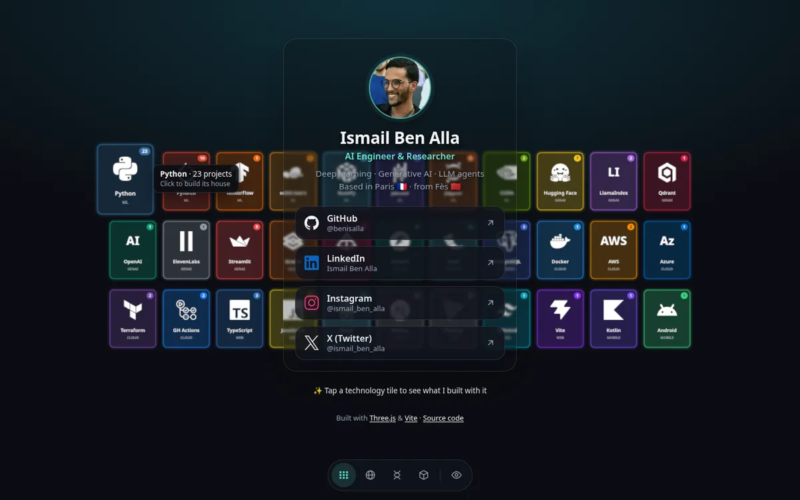
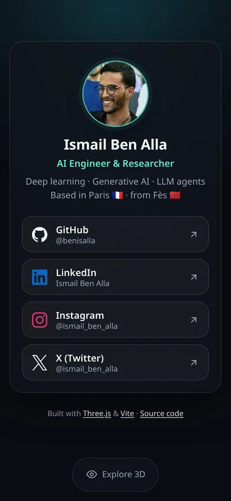
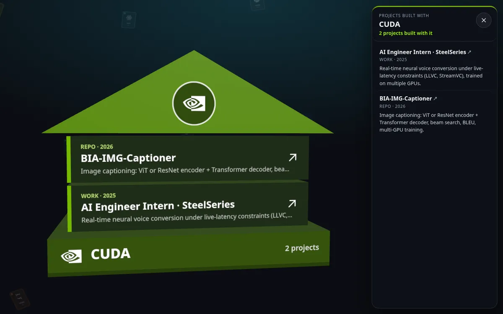
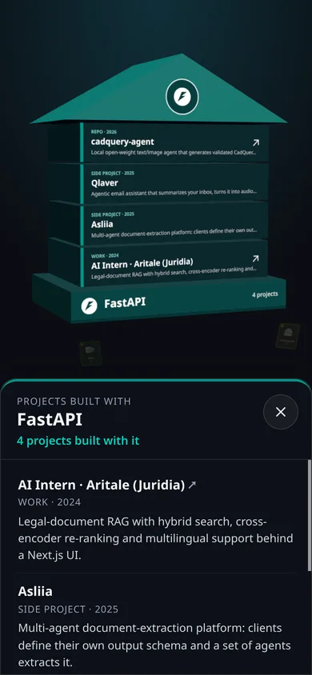

<h1 align="center">Ismail Ben Alla · Link in Bio</h1>

<p align="center">
  A fast, mobile-friendly <b>link-in-bio page</b> (a self-hosted Linktree alternative)<br/>
  with an interactive <b>WebGL 3D tech stack</b>: click a technology and the projects<br/>
  built with it stack up into a 3D house.
</p>

<p align="center">
  <a href="https://benisalla.github.io/ismail-ben-alla-link-in-bio-2022/"><b>🌐 Live site</b></a>
  ·
  <a href="#-run-it-locally">Run it locally</a>
  ·
  <a href="#-make-it-your-own">Make it your own</a>
</p>

<p align="center">
  <a href="https://github.com/benisalla/ismail-ben-alla-link-in-bio-2022/actions/workflows/deploy.yml"></a>
  
  
  
  
</p>

<p align="center">
  
  &nbsp;
  
</p>

## ✨ Features

- **Instant on every device.** The profile card is plain HTML with inlined CSS, so it paints on the first round trip: the links are visible after only about **28 KB**.
- **3D tech stack (WebGL).** 33 technologies float behind the card as a periodic table that morphs into a **sphere, helix or grid**. Drag to rotate, scroll to zoom.
- **Hover a tile** and it lifts toward you, with a tooltip showing how many projects use it (the number is also on each tile's badge).
- **Click a tile to build its house.** The other tiles drift away, the technology becomes the **foundation**, and every project, job or side project built with it **drops in as a floor**, topped by a roof with its logo. Click a floor to open the project; a side panel (bottom sheet on phones) lists everything. Close with ×, <kbd>Esc</kbd> or a click on empty space.
- **Smooth.** One shared texture atlas and material for all tiles, a render loop that sleeps when nothing moves, shaders compiled in parallel before the first frame, and a lighter mode for devices without GPU acceleration. 60 fps on a laptop iGPU.
- **Responsive.** Tested from 360 px Android phones to wide desktop screens, in portrait and landscape, with safe-area support for notched phones.
- **Good link previews.** Open Graph and Twitter Card tags plus a 1200×630 preview image, so the link looks right on LinkedIn, X, WhatsApp, Slack and Discord. Also includes JSON-LD `Person` data for search engines.
- **Accessible.** Semantic HTML, keyboard focus styles, 44 px+ touch targets, labels on every icon button, and a real HTML list of projects next to each 3D house.
- **No fonts, no icon CDN, no trackers.** The only libraries are Three.js and Tween.js, loaded after the links.
- **Auto-deploy** to GitHub Pages on every push (GitHub Actions).

<p align="center">
  
  &nbsp;
  
</p>

## 🧰 Tech stack

| What | Used for |
|---|---|
| [Vite 8](https://vite.dev/) | Dev server and production build (code splitting, CSS inlining) |
| [Three.js r186](https://threejs.org/) | `WebGLRenderer`, `OrbitControls`, raycasting for hover/click, extruded roof geometry |
| [Tween.js 25](https://github.com/tweenjs/tween.js) | Layout morphs, hover lifts, falling floors, camera moves |
| [Simple Icons](https://simpleicons.org/) | Brand logos as SVG paths, drawn into canvas textures (only the used icons are bundled) |
| Canvas 2D | Generates the tile atlas and the floor / foundation / roof textures at runtime |
| Vanilla JS + modern CSS | No framework; `color-mix()`, `dvh`, `backdrop-filter`, safe-area insets |
| GitHub Actions + Pages | Build and deploy on push to `master` |

## 🚀 Run it locally

Requires **Node.js 20.19+** (22 LTS recommended).

```bash
git clone https://github.com/benisalla/ismail-ben-alla-link-in-bio-2022.git
cd ismail-ben-alla-link-in-bio-2022
npm install

npm run dev       # dev server with hot reload, http://localhost:5173
npm run build     # production build in dist/
npm run preview   # serve the production build, http://localhost:4173
```

## 📁 Project structure

```
├── index.html            # the page: card, links, SEO / social meta tags
├── src/
│   ├── main.js           # tiny entry: explore buttons + loads the 3D scene when the page is idle
│   ├── scene.js          # WebGL scene: tiles, layouts, hover, houses, render-on-demand loop
│   ├── stack.js          # the technologies shown as 3D tiles
│   ├── projects.js       # projects, jobs and side projects, tagged with the technologies they use
│   └── style.css         # all styles (inlined into index.html at build time)
├── public/               # copied as-is: avatar, favicon, social preview image, manifest
├── vite.config.js
└── .github/workflows/deploy.yml
```

## 🎨 Make it your own

1. **Links and name:** edit the `<section class="card">` block in `index.html`. Each link is an `<a class="link">`; `--brand` sets its hover color.
2. **Meta tags:** update the `<title>`, `description`, `og:*` tags, `canonical` URL and the JSON-LD block at the top of `index.html`.
3. **Photo and preview image:** replace `public/avatar-160.webp`, `public/avatar-320.webp` (square) and `public/og-image.jpg` (1200×630).
4. **3D tiles:** edit `src/stack.js`. Import any icon from [Simple Icons](https://simpleicons.org/) (`siPython`, `siReact`, ...) or use a short text monogram like `'AWS'`.
5. **Houses:** edit `src/projects.js`. Each entry has a `title`, `kind` (Repo / Work / Side project), `year`, `desc`, optional `url`, and the `tech` names it was built with. The first entries become the lowest floors; a house shows up to 7 floors and the panel lists all of them.
6. **Deploy:** push to GitHub, then go to **Settings → Pages → Source** and pick **GitHub Actions**. Since `base` is relative, the build also works as-is on Vercel, Netlify or Cloudflare Pages.

## ⚡ Why it is fast

The 2022 version shipped ~14 MB on first load: 150 full-size PNG logos (some 700 KB each), a 1 MB photo, the whole Font Awesome CSS, the Twitter widget script (four times) and the full Three.js bundle, all before the links appeared. Its 3D view animated 150 HTML elements, which spent most of each frame restyling the page.

| | 2022 | Now |
|---|---|---|
| Downloaded before the links are visible | ~14 MB | **~28 KB** (3D loads afterwards, ~175 KB gzipped) |
| Requests before the links are visible | 150+ | **3** |
| 3D animation, laptop (Intel Iris Xe) | ~10–40 fps | **60 fps** |
| 3D animation, slow phone (4× CPU throttling) | ~6–11 fps | **~30 fps** |
| Repository size (tracked files) | ~145 MB incl. `node_modules` | **< 350 KB** |

> Lighthouse scores 100 for accessibility, best practices and SEO. Its performance score (≈60–70 on mobile) is lower than real-world speed because Lighthouse renders WebGL on the CPU without a GPU; the links themselves are visible in ~1.3 s on its slow-phone simulation.

## 👋 About me

I'm **Ismail Ben Alla**, an AI engineer and researcher based in **Paris** 🇫🇷 (originally from Fès 🇲🇦). I work on deep learning, generative AI and LLM agents, and I like rebuilding models from scratch to understand how they work. More on my [GitHub profile](https://github.com/benisalla).

<p>
  <a href="https://github.com/benisalla"></a>
  <a href="https://www.linkedin.com/in/ismail-ben-alla-7144b5221/"></a>
  <a href="https://www.instagram.com/ismail_ben_alla/"></a>
  <a href="https://twitter.com/ismail_ben_alla/"></a>
  <a href="mailto:ismailbenalla52@gmail.com"></a>
</p>

## 📄 License

[MIT](LICENSE). Fork it and make it yours. A ⭐ is always appreciated!

<sub>Keywords: link in bio, linktree alternative, bio link page, personal landing page, developer portfolio, three.js, webgl, 3d periodic table, interactive 3d portfolio, vite, vanilla javascript, github pages, responsive, open source.</sub>
