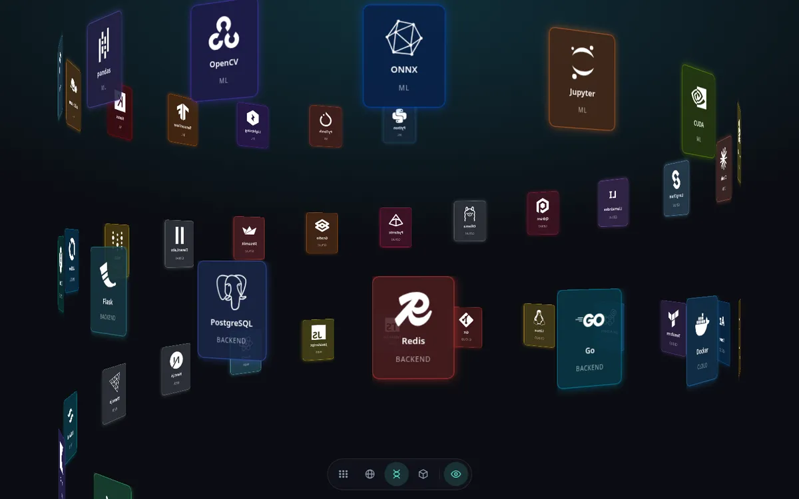

<h1 align="center">Ismail Ben Alla · Link in Bio</h1>

<p align="center">
  A fast, mobile-friendly <b>link-in-bio page</b> (a self-hosted Linktree alternative)<br/>
  with an interactive <b>Three.js 3D tech-stack</b> background.
</p>

<p align="center">
  <a href="https://benisalla.github.io/ismail-ben-alla-link-in-bio-2022/"><b>🌐 Live site</b></a>
  ·
  <a href="#-run-it-locally">Run it locally</a>
  ·
  <a href="#-make-it-your-own">Make it your own</a>
</p>

<p align="center">
  <a href="https://github.com/benisalla/ismail-ben-alla-link-in-bio-2022/actions/workflows/deploy.yml"></a>
  
  
  
  
</p>

<p align="center">
  
  &nbsp;
  
</p>

## ✨ Features

- **Instant on every device.** The profile card is plain HTML with inlined CSS, so it paints on the first round trip. A phone downloads about **28 KB** in total.
- **3D tech stack, without the cost.** 45 technologies are shown as a periodic table you can morph into a **sphere, helix or grid** and rotate with the mouse. Built with `CSS3DRenderer` from Three.js.
  - On desktop it loads after the page is idle.
  - On phones it loads only when you tap **Explore 3D**.
  - It is skipped entirely with *reduced motion* or *data saver* turned on.
- **Responsive.** Tested from 360 px Android phones to wide desktop screens, in portrait and landscape, with safe-area support for notched phones.
- **Good link previews.** Open Graph and Twitter Card tags plus a 1200×630 preview image, so the link looks right on LinkedIn, X, WhatsApp, Slack and Discord. Also includes JSON-LD `Person` data for search engines.
- **Accessible.** Semantic HTML, keyboard focus styles, 44 px+ touch targets, and labels on every icon button.
- **Zero runtime dependencies** besides Three.js and Tween.js, and only in the lazy 3D chunk. No fonts, no icon CDN, no trackers.
- **Auto-deploy** to GitHub Pages on every push (GitHub Actions).

<p align="center">
  
</p>

## 🧰 Tech stack

| What | Used for |
|---|---|
| [Vite 8](https://vite.dev/) | Dev server and production build (code splitting, CSS inlining) |
| [Three.js r186](https://threejs.org/) | `CSS3DRenderer` and `TrackballControls` for the 3D background |
| [Tween.js 25](https://github.com/tweenjs/tween.js) | Smooth transitions between the 3D layouts |
| [Simple Icons](https://simpleicons.org/) | Brand logos as inline SVG (only the used icons are bundled) |
| Vanilla JS + modern CSS | No framework; `color-mix()`, `dvh`, `backdrop-filter`, safe-area insets |
| GitHub Actions + Pages | Build and deploy on push to `master` |

## 🚀 Run it locally

Requires **Node.js 20.19+** (22 LTS recommended).

```bash
git clone https://github.com/benisalla/ismail-ben-alla-link-in-bio-2022.git
cd ismail-ben-alla-link-in-bio-2022
npm install

npm run dev       # dev server with hot reload, http://localhost:5173
npm run build     # production build in dist/
npm run preview   # serve the production build, http://localhost:4173
```

## 📁 Project structure

```
├── index.html            # the page: card, links, SEO / social meta tags
├── src/
│   ├── main.js           # tiny entry: explore button + lazy-loads the 3D scene
│   ├── scene.js          # Three.js CSS3D scene, layouts, controls, render-on-demand loop
│   ├── stack.js          # the technologies shown as 3D tiles
│   └── style.css         # all styles (inlined into index.html at build time)
├── public/               # copied as-is: avatar, favicon, social preview image, manifest
├── vite.config.js
└── .github/workflows/deploy.yml
```

## 🎨 Make it your own

1. **Links and name:** edit the `<section class="card">` block in `index.html`. Each link is an `<a class="link">`; `--brand` sets its hover color.
2. **Meta tags:** update the `<title>`, `description`, `og:*` tags, `canonical` URL and the JSON-LD block at the top of `index.html`.
3. **Photo and preview image:** replace `public/avatar-160.webp`, `public/avatar-320.webp` (square) and `public/og-image.jpg` (1200×630).
4. **3D tiles:** edit `src/stack.js`. Import any icon from [Simple Icons](https://simpleicons.org/) (`siPython`, `siReact`, ...) or use a short text monogram like `'AWS'`.
5. **Deploy:** push to GitHub, then go to **Settings → Pages → Source** and pick **GitHub Actions**. Since `base` is relative, the build also works as-is on Vercel, Netlify or Cloudflare Pages.

## ⚡ Why it is fast

The 2022 version shipped ~14 MB on first load: 150 full-size PNG logos (some 700 KB each), a 1 MB photo, the whole Font Awesome CSS, the Twitter widget script (four times) and the full Three.js bundle, all before the links appeared. This version:

| | 2022 | Now |
|---|---|---|
| First load (phone) | ~14 MB | **~28 KB** |
| Requests before the links are visible | 150+ | **3** |
| Lighthouse performance (mobile) | low | **100** |
| Repository size (tracked files) | ~145 MB incl. `node_modules` | **< 300 KB** |

## 👋 About me

I'm **Ismail Ben Alla**, an AI engineer and researcher based in **Paris** 🇫🇷 (originally from Fès 🇲🇦). I work on deep learning, generative AI and LLM agents, and I like rebuilding models from scratch to understand how they work. More on my [GitHub profile](https://github.com/benisalla).

<p>
  <a href="https://github.com/benisalla"></a>
  <a href="https://www.linkedin.com/in/ismail-ben-alla-7144b5221/"></a>
  <a href="https://www.instagram.com/ismail_ben_alla/"></a>
  <a href="https://twitter.com/ismail_ben_alla/"></a>
  <a href="mailto:ismailbenalla52@gmail.com"></a>
</p>

## 📄 License

[MIT](LICENSE). Fork it and make it yours. A ⭐ is always appreciated!

<sub>Keywords: link in bio, linktree alternative, bio link page, personal landing page, developer portfolio, three.js, css3d, 3d periodic table, vite, vanilla javascript, github pages, responsive, open source.</sub>
